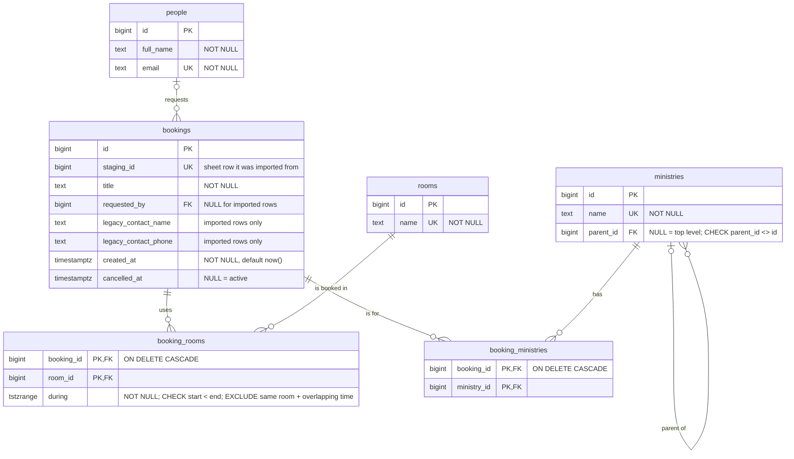

# Database ERD

Generated from `backend/src/main/resources/db/migration/V1__init.sql`. Update this file whenever a migration changes the schema.

## How to read the lines

| Symbol at a line's end | Meaning |
| --- | --- |
| `\|\|` | exactly one |
| `\|o` | zero or one |
| `o{` | zero or more |
| `\|{` | one or more |

Read each line from one table to the other. For example, `rooms ||--o{ booking_rooms`: each `booking_rooms` row points to exactly one room, and each room has zero or more `booking_rooms` rows.

## Rules the diagram can't show

- **No double booking:** `booking_rooms_no_overlap` rejects two rows with the same `room_id` and overlapping `during`. Ranges are half open (`[)`), so back to back bookings are allowed.
- **Cancelled bookings still block their room:** the exclusion constraint doesn't look at `bookings.cancelled_at` yet. Open decision: copy `cancelled_at` onto `booking_rooms`, or delete the room rows on cancel.
- **A booking with no rooms is allowed by the database.** Nothing forces at least one `booking_rooms` row, so the booking service must check it.
- **Short notice** (under 2 weeks) is derived from `created_at` and the start time, not stored.
